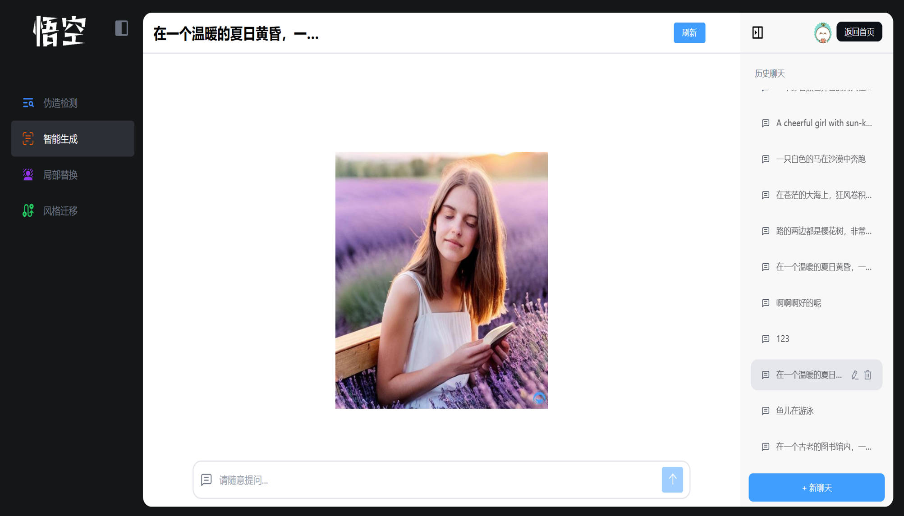
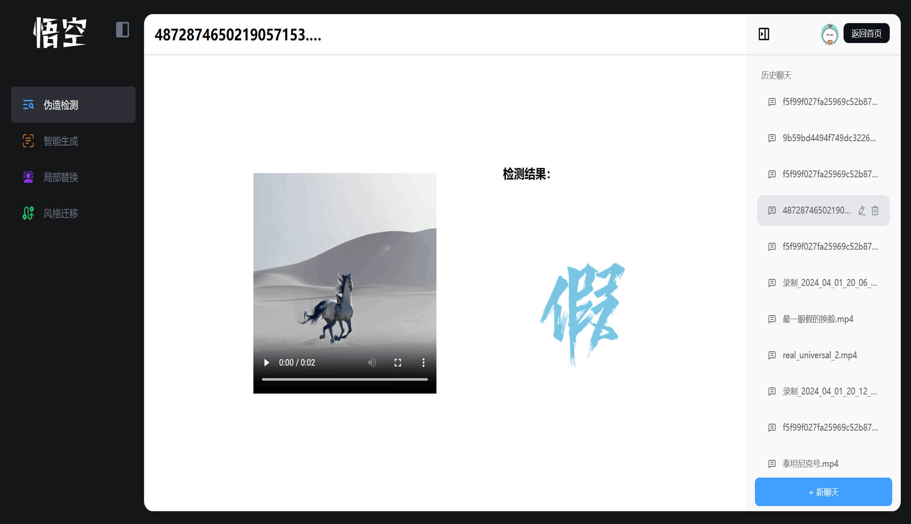

# 项目简介

本仓库是**悟空智能**的前端代码，基于 Vue3 开发。
后端模型部署，采用Flask框架，其中检测模块仓库：[DetectionCode](https://github.com/YueTwo/DetectionCode)

# 项目运行

```bash
npm install pnpm
pnpm install
pnpm dev
```

# 实现功能

1. 七十二变：跨模态生成模块
2. 火眼金睛：伪造检测模块

# 实现效果

## 一、七十二变
### 1. 文本指示下的影像创作



### 2. 文本指示下的目标替换


### 3. 文本指示下的风格迁移


## 二、火眼金睛

### 1. PS图像篡改区域可视化


### 2. 多人脸影像的伪造检测


### 3. 全局AIGC图片/视频检测



